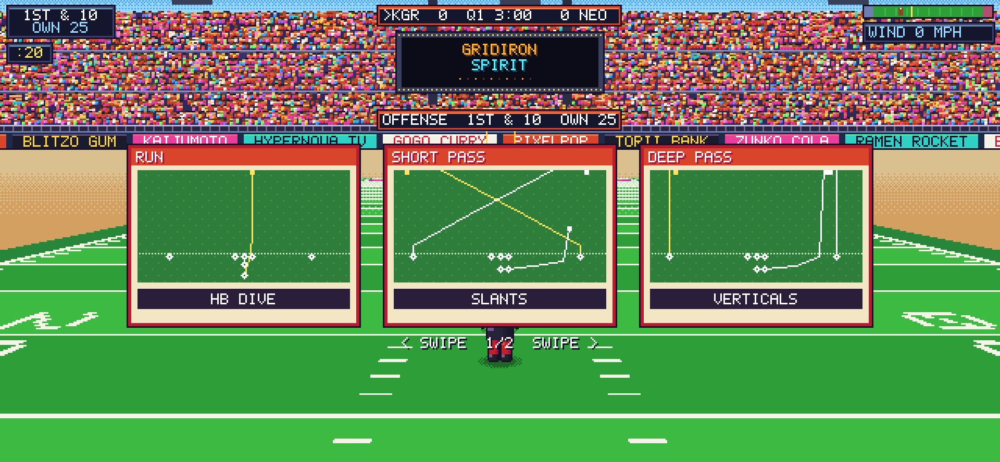
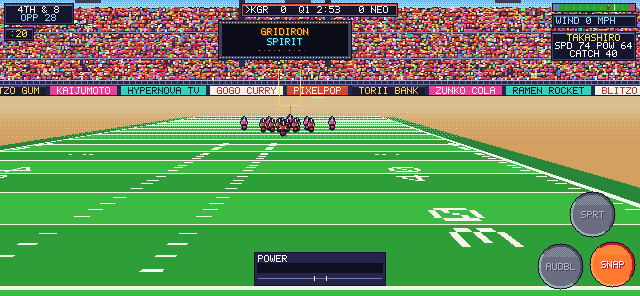
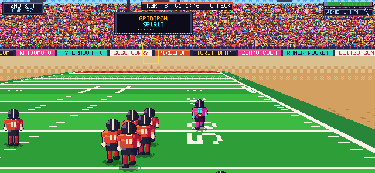

# GRIDIRON SPIRIT (working title)

An arcade-style, anime-flavoured American football game for iPhone, set in the
16-bit era. Swift 5.9+, SpriteKit and Metal, iOS 17+, landscape only. All
teams, players, sponsors and stadiums are original.

**Status: Milestone 3 done.** You can now play a full 7v7 game:
- **Plays:** 6 offensive and 6 defensive, called from cards with chalkboard diagrams.
- **AI:** a CPU quarterback that reads coverage.
- **Rules:** downs, scoring (TD, PAT, 2-pt, FG, safety), punts, field goals with a kick meter, wind, a 4 × 3:00 clock, false starts and pass interference.
- **Sides:** you play offense and defense.

See [MILESTONES.md](MILESTONES.md) for summaries and checklists, and
[DECISIONS.md](DECISIONS.md) for the reasoning.

| Play call | Field goal + kick meter | CPU drive to a TD |
|---|---|---|
|  |  |  |

| Bullet slant | Lob go route | Open-field speed lines |
|---|---|---|
|  |  |  |

These GIFs are real plays run by the game code and rendered on the CPU by `gs-preview`.

## Layout

```
GridironSpirit/
├── project.yml                  XcodeGen spec (iOS app + local package)
├── App/                         iOS-only layer: UIKit / Metal / SpriteKit wiring
│   ├── Sources/App/             AppDelegate, GameViewController, GameController (frame driver)
│   ├── Sources/Rendering/       PixelPipeline (SKRenderer -> 640x296 -> integer upscale),
│   │                            Upscale.metal, WorldRenderer (node sync), TextureFactory
│   ├── Sources/Scenes/          GameScene: layers only, no logic
│   ├── Sources/UI/              DebugOverlay (pixel-font diagnostics)
│   ├── Sources/Haptics/         Core Haptics transient player
│   └── Support/Info.plist
├── Packages/GridironCore/       Platform-independent Swift package (builds and tests on Linux too)
│   ├── GSFoundation             Vec2/Vec3, RGBA + hue-shift shading, SplitMix64, FixedTimestep, Rect
│   ├── GSData                   Codable team/player/playbook models + teams.json, plays.json
│   ├── GSSimulation             Field, MovementProfile, PlayerBody, Ball (drag/wind/prolate bounce),
│   │                            ThrowSolver, KickPhysics, Catch/Tackle resolvers, World, Formation
│   ├── GSInput                  Floating VirtualJoystick, TouchRouter (context buttons, receiver icons)
│   ├── GSAI                     Data-driven assignments, CPU QB reads, run/stalk blocking, daylight running,
│   │                            lead-angle pursuit, PlayCaller (situational calls, 4th down, PAT/2), KickAI
│   ├── GSRules                  GameState + Referee: downs, scoring, clock, penalties, quarters
│   ├── GSRenderCore             Camera, CameraRig, FieldRasterizer, StadiumBackdrop, PixelFont,
│   │                            PlaceholderSprites (poses), FXSprites, EffectsRasterizer, CanvasLayout
│   ├── GSGame                   GameRuntime (match flow, hit-stop, kicks), FX, UILayout (HUD/cards), SpecialPlays
│   └── gs-preview               Dev tool: renders frames to PNG on the CPU
└── docs/m1, m2, m3/             Preview renders, GIFs and a full-game play-by-play from gs-preview
```

The UI (menus/HUD) and Audio modules arrive in M5, so there are no empty stubs yet.

## Build and run on iPhone

```sh
brew install xcodegen
cd GridironSpirit
xcodegen generate
open GridironSpirit.xcodeproj
```

Set your signing team, pick a physical iPhone and run. The **GridironSpirit**
scheme runs in **Release**, because the per-frame CPU field raster is about 10x
slower unoptimized. Use **GridironSpirit (Debug)** when you need the debugger.

## Test the core (macOS or Linux)

```sh
cd Packages/GridironCore
swift test                              # 90 unit tests incl. 2 full CPU-vs-CPU games
swift run -c release gs-preview /tmp    # plays scripted snaps, writes stills + raw frames
```

On Linux without a toolchain: `docker run --rm -v "$PWD":/pkg -w /pkg swift:5.10-jammy swift test`.
