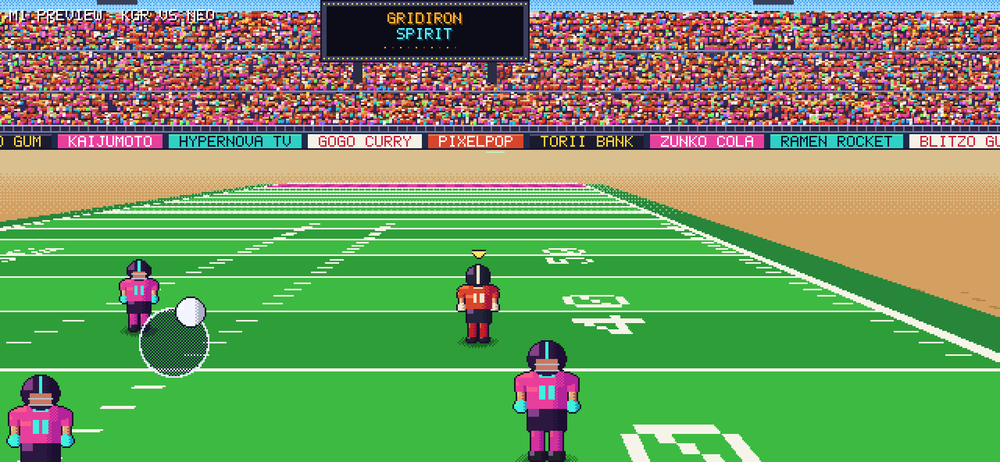

# GRIDIRON SPIRIT (working title)

An arcade-style, anime-flavoured American football game for iPhone, set in the
16-bit era. Swift 5.9+, SpriteKit and Metal, iOS 17+, landscape only. All
teams, players, sponsors and stadiums are original.

**Status: Milestone 1 done** (pixel-perfect render pipeline, projected field,
camera, one player running with the joystick). See [MILESTONES.md](MILESTONES.md)
for the summary and the test checklist, and [DECISIONS.md](DECISIONS.md) for the reasoning.



## Layout

```
GridironSpirit/
├── project.yml                  XcodeGen spec (iOS app + local package)
├── App/                         iOS-only layer: UIKit / Metal / SpriteKit wiring
│   ├── Sources/App/             AppDelegate, GameViewController, GameController (frame driver)
│   ├── Sources/Rendering/       PixelPipeline (SKRenderer -> 640x296 -> integer upscale),
│   │                            Upscale.metal, WorldRenderer (node sync), TextureFactory
│   ├── Sources/Scenes/          GameScene: layers only, no logic
│   ├── Sources/UI/              DebugOverlay (pixel-font diagnostics)
│   └── Support/Info.plist
├── Packages/GridironCore/       Platform-independent Swift package (builds and tests on Linux too)
│   ├── GSFoundation             Vec2/Vec3, RGBA + hue-shift shading, SplitMix64, FixedTimestep, Rect
│   ├── GSData                   Codable team/player models + Resources/teams.json
│   ├── GSSimulation             Field geometry, MovementProfile, PlayerBody, World, Formation
│   ├── GSInput                  Floating VirtualJoystick, TouchRouter
│   ├── GSRenderCore             Camera projection, CameraRig, FieldRasterizer, StadiumBackdrop,
│   │                            PixelFont, PlaceholderSprites, CanvasLayout
│   ├── GSGame                   GameRuntime (loop + interpolation + projection), FrameRateGovernor
│   └── gs-preview               Dev tool: renders frames to PNG on the CPU
└── docs/m1/                     Preview renders produced by gs-preview
```

The AI, UI (menus/HUD), Audio and haptics modules arrive in the milestones that
need them (M3, M5 and M6), so there are no empty stub modules yet.

## Build and run on iPhone

```sh
brew install xcodegen
cd GridironSpirit
xcodegen generate
open GridironSpirit.xcodeproj
```

Set your signing team, pick a physical iPhone and run. The **GridironSpirit**
scheme runs in **Release**, because the per-frame CPU field raster is about 10x
slower unoptimized. Use **GridironSpirit (Debug)** when you need the debugger.

## Test the core (macOS or Linux)

```sh
cd Packages/GridironCore
swift test                              # 43 unit tests
swift run -c release gs-preview /tmp    # writes preview PNGs + raster timing
```

On Linux without a toolchain: `docker run --rm -v "$PWD":/pkg -w /pkg swift:5.10-jammy swift test`.
