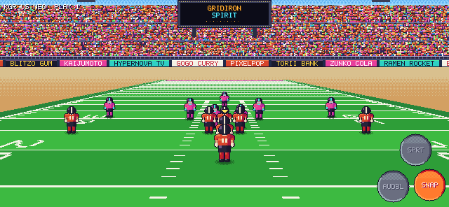
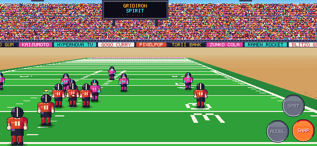
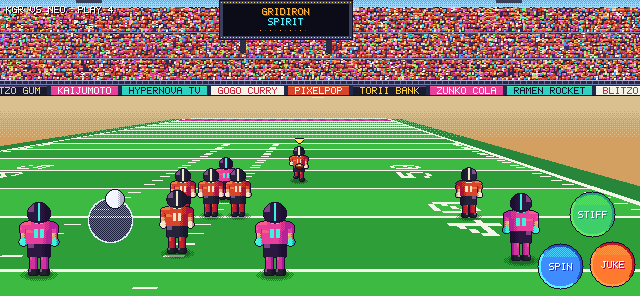

# GRIDIRON SPIRIT (working title)

An arcade-style, anime-flavoured American football game for iPhone, set in the
16-bit era. Swift 5.9+, SpriteKit and Metal, iOS 17+, landscape only. All
teams, players, sponsors and stadiums are original.

**Status: Milestone 2 done.** M2 adds ball physics, passing, catching,
tackling and hit-stop, plus the anime effects layer. See [MILESTONES.md](MILESTONES.md)
for the summaries and test checklists, and [DECISIONS.md](DECISIONS.md) for the reasoning.

| Bullet slant | Lob go route | Open-field speed lines |
|---|---|---|
|  |  |  |

These GIFs are real plays run by the game code and rendered on the CPU by `gs-preview`.

## Layout

```
GridironSpirit/
├── project.yml                  XcodeGen spec (iOS app + local package)
├── App/                         iOS-only layer: UIKit / Metal / SpriteKit wiring
│   ├── Sources/App/             AppDelegate, GameViewController, GameController (frame driver)
│   ├── Sources/Rendering/       PixelPipeline (SKRenderer -> 640x296 -> integer upscale),
│   │                            Upscale.metal, WorldRenderer (node sync), TextureFactory
│   ├── Sources/Scenes/          GameScene: layers only, no logic
│   ├── Sources/UI/              DebugOverlay (pixel-font diagnostics)
│   ├── Sources/Haptics/         Core Haptics transient player
│   └── Support/Info.plist
├── Packages/GridironCore/       Platform-independent Swift package (builds and tests on Linux too)
│   ├── GSFoundation             Vec2/Vec3, RGBA + hue-shift shading, SplitMix64, FixedTimestep, Rect
│   ├── GSData                   Codable team/player models + Resources/teams.json
│   ├── GSSimulation             Field, MovementProfile, PlayerBody, Ball (drag/wind/prolate bounce),
│   │                            ThrowSolver, KickPhysics, Catch/Tackle resolvers, World, Formation
│   ├── GSInput                  Floating VirtualJoystick, TouchRouter (context buttons, receiver icons)
│   ├── GSAI                     Lead-angle pursuit, man/zone coverage, routes, pass rush/block, Difficulty
│   ├── GSRenderCore             Camera, CameraRig, FieldRasterizer, StadiumBackdrop, PixelFont,
│   │                            PlaceholderSprites (poses), FXSprites, EffectsRasterizer, CanvasLayout
│   ├── GSGame                   GameRuntime (loop, hit-stop, play lifecycle), FX events, FrameRateGovernor
│   └── gs-preview               Dev tool: renders frames to PNG on the CPU
└── docs/m1, docs/m2/            Preview renders and GIFs produced by gs-preview
```

The UI (menus/HUD) and Audio modules arrive in M5, so there are no empty stubs yet.

## Build and run on iPhone

```sh
brew install xcodegen
cd GridironSpirit
xcodegen generate
open GridironSpirit.xcodeproj
```

Set your signing team, pick a physical iPhone and run. The **GridironSpirit**
scheme runs in **Release**, because the per-frame CPU field raster is about 10x
slower unoptimized. Use **GridironSpirit (Debug)** when you need the debugger.

## Test the core (macOS or Linux)

```sh
cd Packages/GridironCore
swift test                              # 70 unit tests
swift run -c release gs-preview /tmp    # plays scripted snaps, writes stills + raw frames
```

On Linux without a toolchain: `docker run --rm -v "$PWD":/pkg -w /pkg swift:5.10-jammy swift test`.
