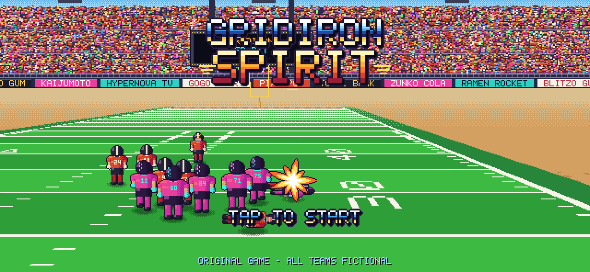
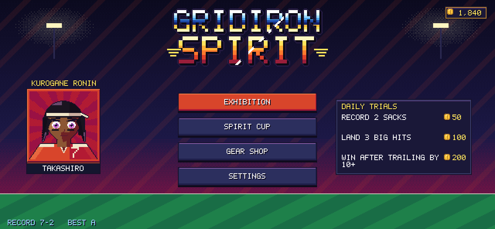
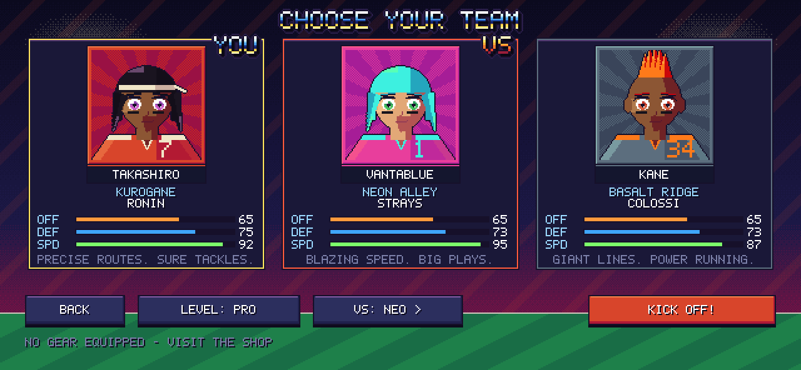
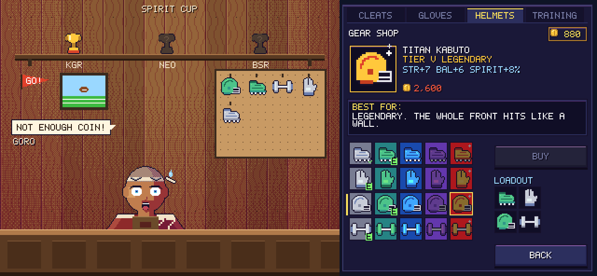
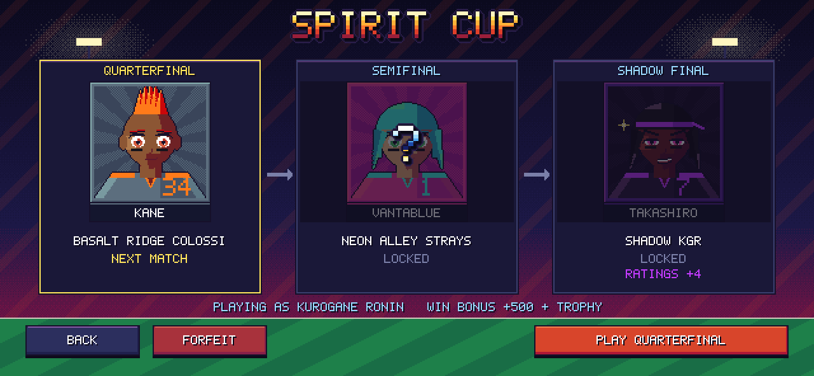
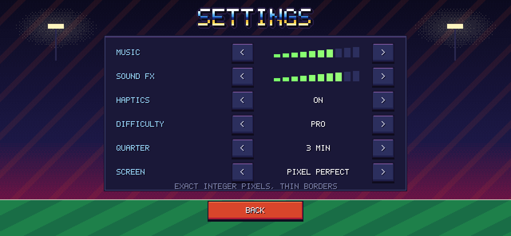
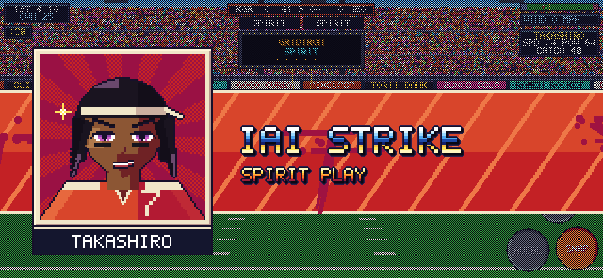
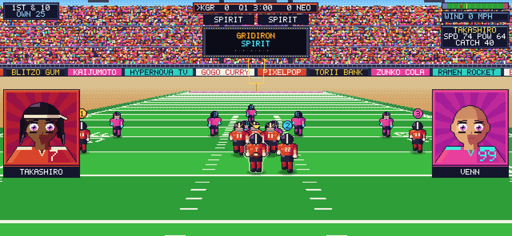
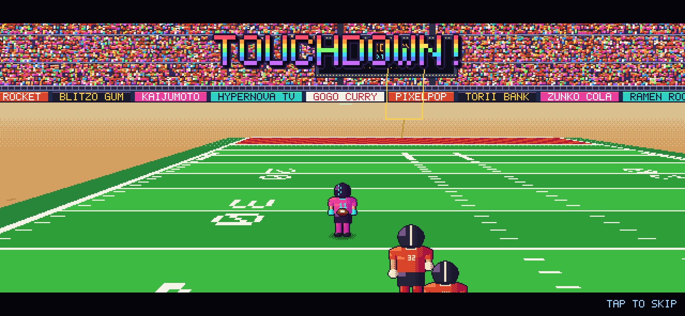

# GRIDIRON SPIRIT (working title)

An arcade-style, anime-flavoured American football game for iPhone, set in the
16-bit era. Swift 5.9+, SpriteKit and Metal, iOS 17+, landscape only. All
teams, players, sponsors and stadiums are original.

**Status: Milestone 5 done.** The game is now a complete app loop:
- A title screen over a live CPU-vs-CPU attract game, then the main menu, team select, settings and pause.
- **Gear shop**: a wood-paneled room with shopkeeper Goro, a trophy shelf and a pegboard of your gear. A right-hand panel has tabs, coins, a preview, "Best for:" text and a 5x4 grid. Equipped gear boosts your team's ratings in-game.
- **Spirit Cup**: a 3-round ladder ending in a mirror match against your team's Shadow. Cup wins put trophies on the shop wall.
- **Original chiptune/FM audio**: 4 songs and 13 SFX, synthesized live (no audio files), with a crowd bed that swells on big plays.
- Settings persist: volume, haptics, difficulty, quarter length, and pixel-perfect vs. sharp-fill scaling.

M1–M4 built the engine, ball physics, rules, AI, the anime art pass, Spirit Plays and replays.
See [MILESTONES.md](MILESTONES.md) and [DECISIONS.md](DECISIONS.md).

| Title (attract mode) | Main menu | Team select |
|---|---|---|
|  |  |  |
| **Gear shop** | **Spirit Cup** | **Settings** |
|  |  |  |

| Spirit cut-in (M4) | Snap matchup (M4) | Instant replay (M4) |
|---|---|---|
|  |  |  |

Listen: [title](docs/m5/spirit_rising.wav) · [menu](docs/m5/locker_room.wav) · [in-game](docs/m5/gridiron_drive.wav) · [touchdown](docs/m5/touchdown.wav) · [SFX reel](docs/m5/sfx_reel.wav)

## Layout

```
GridironSpirit/
├── project.yml                  XcodeGen spec (iOS app + local package)
├── App/                         iOS-only layer: UIKit / Metal / SpriteKit wiring
│   ├── Sources/App/             AppDelegate, GameViewController, GameController (frame driver)
│   ├── Sources/Rendering/       PixelPipeline (SKRenderer -> 640x296 -> integer upscale),
│   │                            Upscale.metal, WorldRenderer (node sync), TextureFactory
│   ├── Sources/Scenes/          GameScene: layers only, no logic
│   ├── Sources/UI/              DebugOverlay (pixel-font diagnostics)
│   ├── Sources/Haptics/         Core Haptics transient player
│   ├── Sources/Audio/           AudioOutput: AVAudioEngine source node pulling the GSAudio synth
│   └── Support/Info.plist
├── Packages/GridironCore/       Platform-independent Swift package (builds and tests on Linux too)
│   ├── GSFoundation             Vec2/Vec3, RGBA + hue-shift shading, SplitMix64, FixedTimestep, Rect
│   ├── GSData                   Codable team/player/playbook/Spirit/gear models
│   │                            + teams.json, plays.json, spirits.json, gear.json
│   ├── GSSimulation             Field, MovementProfile, PlayerBody, Ball (drag/wind/prolate bounce),
│   │                            ThrowSolver, KickPhysics, Catch/Tackle resolvers, World, Formation
│   ├── GSInput                  Floating VirtualJoystick, TouchRouter (context buttons, receiver icons)
│   ├── GSAI                     Data-driven assignments, CPU QB reads, run/stalk blocking, daylight running,
│   │                            lead-angle pursuit, PlayCaller (situational calls, 4th down, PAT/2), KickAI
│   ├── GSRules                  GameState + Referee: downs, scoring, clock, penalties, quarters
│   ├── GSRenderCore             Camera, CameraRig, FieldRasterizer, StadiumBackdrop, PixelFont,
│   │                            PlaceholderSprites (poses, numbers, helmets), FXSprites, Portraits, ArcadeArt,
│   │                            EffectsRasterizer, UIArt, CanvasLayout
│   ├── GSGame                   GameRuntime (match flow, hit-stop, kicks), Showtime (Spirit, portraits, replays),
│   │                            Progression (stats, Spirit Trials, report, coins), Profile + SpiritCup,
│   │                            FX (+ sound cues), UILayout, SpecialPlays
│   ├── GSAudio                  FM/pulse/triangle/LFSR-noise synth, tracker-format Soundtrack, AudioCore mixer
│   ├── GSUI                     AppFlow (all screens, touch routing, match setup), MenuArt, ShopArt
│   └── gs-preview               Dev tool: renders frames to PNG on the CPU
└── docs/m1 … m5/                Preview renders, GIFs, play-by-plays and (M5) WAV renders from gs-preview
```

## Build and run on iPhone

```sh
brew install xcodegen
cd GridironSpirit
xcodegen generate
open GridironSpirit.xcodeproj
```

Set your signing team, pick a physical iPhone and run. The **GridironSpirit**
scheme runs in **Release**, because the per-frame CPU field raster is about 10x
slower unoptimized. Use **GridironSpirit (Debug)** when you need the debugger.
The FPS/frame-time overlay is on in Debug. In Release, enable the `-diagnostics`
launch argument in the scheme editor (it's already listed there, unticked).

## Test the core (macOS or Linux)

```sh
cd Packages/GridironCore
swift test                                      # 124 unit tests incl. full CPU-vs-CPU games
swift run -c release gs-preview /tmp            # plays scripted snaps, writes stills + raw frames
swift run -c release gs-preview /tmp --menus    # drives the real AppFlow, writes every screen
swift run -c release gs-preview /tmp --audio    # renders the soundtrack + SFX reel to WAV
```

On Linux without a toolchain: `docker run --rm -v "$PWD":/pkg -w /pkg swift:5.10-jammy swift test`.
