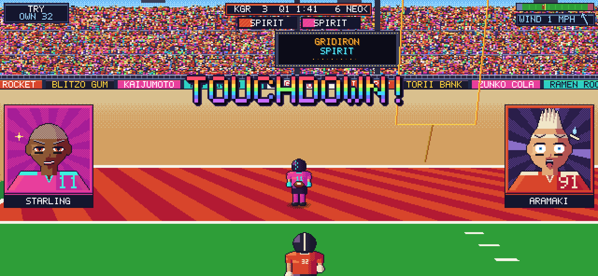
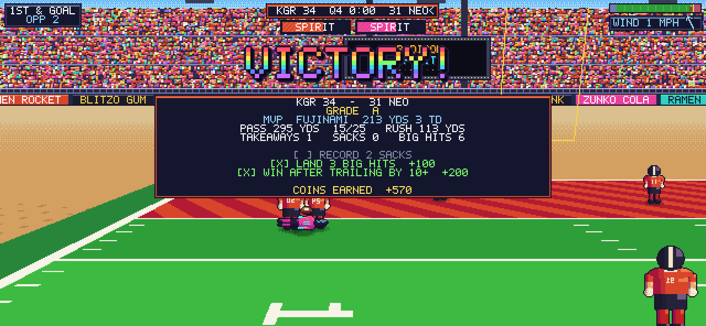
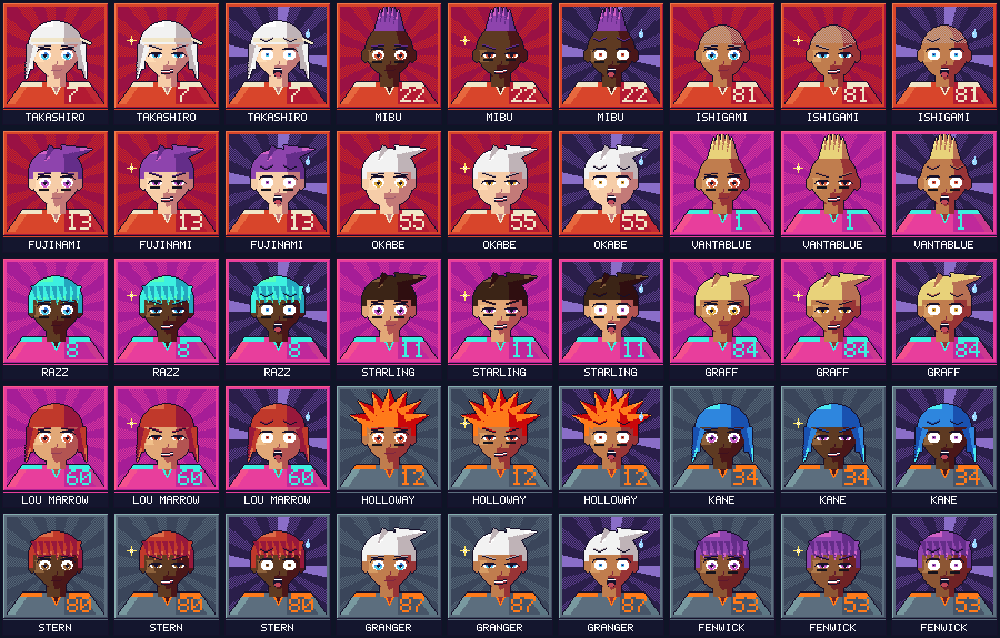

# GRIDIRON SPIRIT (working title)

An arcade-style, anime-flavoured American football game for iPhone, set in the
16-bit era. Swift 5.9+, SpriteKit and Metal, iOS 17+, landscape only. All
teams, players, sponsors and stadiums are original.

**Status: Milestone 4 done.** This milestone is the anime art pass plus the systems that bring players back:
- Procedural bust portraits with 3 expressions, matchup slide-ins at the snap, and reaction portraits after big plays.
- 11 unique Spirit Plays with full-screen cut-ins and real gameplay effects.
- Chrome, rainbow and fire arcade callouts.
- Slow-motion instant replays of highlights.
- College-style overtime.
- Daily Spirit Trials, coins and a graded post-game report card.

See [MILESTONES.md](MILESTONES.md) and [DECISIONS.md](DECISIONS.md).

| Spirit cut-in | Snap matchup | Reaction + TOUCHDOWN! |
|---|---|---|
|  |  |  |
| **Instant replay** | **Report card** | **Portraits (3 expressions)** |
|  |  |  |

## Layout

```
GridironSpirit/
├── project.yml                  XcodeGen spec (iOS app + local package)
├── App/                         iOS-only layer: UIKit / Metal / SpriteKit wiring
│   ├── Sources/App/             AppDelegate, GameViewController, GameController (frame driver)
│   ├── Sources/Rendering/       PixelPipeline (SKRenderer -> 640x296 -> integer upscale),
│   │                            Upscale.metal, WorldRenderer (node sync), TextureFactory
│   ├── Sources/Scenes/          GameScene: layers only, no logic
│   ├── Sources/UI/              DebugOverlay (pixel-font diagnostics)
│   ├── Sources/Haptics/         Core Haptics transient player
│   └── Support/Info.plist
├── Packages/GridironCore/       Platform-independent Swift package (builds and tests on Linux too)
│   ├── GSFoundation             Vec2/Vec3, RGBA + hue-shift shading, SplitMix64, FixedTimestep, Rect
│   ├── GSData                   Codable team/player/playbook/Spirit models + teams.json, plays.json, spirits.json
│   ├── GSSimulation             Field, MovementProfile, PlayerBody, Ball (drag/wind/prolate bounce),
│   │                            ThrowSolver, KickPhysics, Catch/Tackle resolvers, World, Formation
│   ├── GSInput                  Floating VirtualJoystick, TouchRouter (context buttons, receiver icons)
│   ├── GSAI                     Data-driven assignments, CPU QB reads, run/stalk blocking, daylight running,
│   │                            lead-angle pursuit, PlayCaller (situational calls, 4th down, PAT/2), KickAI
│   ├── GSRules                  GameState + Referee: downs, scoring, clock, penalties, quarters
│   ├── GSRenderCore             Camera, CameraRig, FieldRasterizer, StadiumBackdrop, PixelFont,
│   │                            PlaceholderSprites (poses, numbers, helmets), FXSprites, Portraits, ArcadeArt,
│   │                            EffectsRasterizer, UIArt, CanvasLayout
│   ├── GSGame                   GameRuntime (match flow, hit-stop, kicks), Showtime (Spirit, portraits, replays),
│   │                            Progression (stats, Spirit Trials, report, coins), FX, UILayout, SpecialPlays
│   └── gs-preview               Dev tool: renders frames to PNG on the CPU
└── docs/m1 … m4/                Preview renders, GIFs and full-game play-by-plays from gs-preview
```

The UI (menus/HUD) and Audio modules arrive in M5, so there are no empty stubs yet.

## Build and run on iPhone

```sh
brew install xcodegen
cd GridironSpirit
xcodegen generate
open GridironSpirit.xcodeproj
```

Set your signing team, pick a physical iPhone and run. The **GridironSpirit**
scheme runs in **Release**, because the per-frame CPU field raster is about 10x
slower unoptimized. Use **GridironSpirit (Debug)** when you need the debugger.

## Test the core (macOS or Linux)

```sh
cd Packages/GridironCore
swift test                              # 104 unit tests incl. 3 full CPU-vs-CPU games
swift run -c release gs-preview /tmp    # plays scripted snaps, writes stills + raw frames
```

On Linux without a toolchain: `docker run --rm -v "$PWD":/pkg -w /pkg swift:5.10-jammy swift test`.
