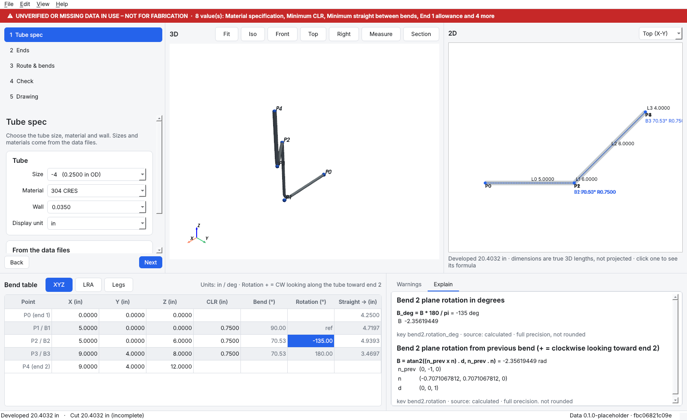

# FlareLine

A tube bend and 37° flare design aid for rigid tube assemblies used in test
systems: GSE, test stands and pressure panels.

> **Design aid only.** All geometry must be verified and approved per your
> organization's engineering and quality process before fabrication.

FlareLine runs fully offline. It makes no network calls and has no telemetry.

## Status

| Phase | Scope | State |
|---|---|---|
| 1 | Geometry engine + tests | **done** |
| 2 | Standards data files (AS4330 / AS33611 / J514) + validation wiring | **done** |
| 3 | GUI shell, live 3D / 2D views | **done** |
| 4 | Drawing export (PDF / DXF / PNG / CSV) | next |
| 5 | Image trace mode | |
| 6 | Packaging (.exe), tutorial, polish | |

## Layout

```
flareline/
  src/flareline/geometry/   pure calculation, no GUI and no I/O
    route.py         TubeRoute: XYZ points + CLR per bend
    analysis.py      angles, tangents, arcs, straights, rotations, lengths, traces
    formats.py       XYZ <-> LRA (YBC) <-> leg-length conversions
    centerline.py    dense centerline sampling (arcs are true circles)
    interference.py  self-interference check
    validation.py    limit checks -> warnings / errors
    springback.py    springback table
    trace.py         formula + inputs record for every calculated number
    units.py         display formatting (the only place values are rounded)
  src/flareline/data/       standards / shop data tables
    defaults/*.json  shipped PLACEHOLDER data set (no standards values)
    schema.py        table format, provenance rules (VERIFIED needs full source)
    store.py         loading, SHA-256 hashing, DataEditor with CHANGELOG.jsonl
    fields_report.py list of every field still to fill in
  src/flareline/project/    project file, data resolution, evaluation, audit log
  src/flareline/app/        PySide6 desktop app (wizard, 3D, 2D, bend table, warnings)
  src/flareline/samples/    sample projects (simple 90°, S-offset, 3D compound)
  tools/make_placeholder_data.py   regenerates the placeholder data set
  tests/             known-answer and property tests
  docs/              CONVENTIONS.md, TEST_REPORT.md, STANDARDS_DATA_FIELDS.md
```

## Standards data

FlareLine ships **no standards values**. Every AS4330, AS33611, J514 and shop-limit
value is null and marked `UNVERIFIED – REPLACE FROM STANDARD` (or `… FROM SHOP DATA`).
`docs/STANDARDS_DATA_FIELDS.md` lists every field to fill in. Regenerate it with
`python -m flareline.data.fields_report`.

- A row can be **VERIFIED** only when its source (standard, revision, table, date entered,
  entered by) and every required value are filled in. The loader refuses anything less.
- Any missing or unverified value that a calculation uses raises a red banner and a
  warning. It also blocks a release drawing, which will be watermarked from Phase 4.
- Edits made through `DataEditor` are validated, written atomically and appended to
  `CHANGELOG.jsonl` (who, when, why, before, after, file hashes). Changing a VERIFIED
  value drops the row back to UNVERIFIED.
- The SHA-256 of the whole data set is recorded in the audit log, and will be printed on
  drawings, so each drawing ties to the exact data that produced it.

## Running the app

```
pip install -e .[gui]
python -m flareline.app            (or the `flareline` command)
```



- **Left:** the 5-step wizard. **Centre:** live 3D view (orbit, pan, zoom, Fit, Iso, Front, Top,
  Right, Measure, Section). **Right:** live 2D view (top / front / side). **Bottom:** the
  bend table (XYZ / LRA / Legs), Warnings and Explain.
- Select any number in the table, the 2D view or a warning to see its formula and its
  full-precision inputs in **Explain**.
- The first run copies the placeholder data set to the app-data folder
  (`%APPDATA%/FlareLine/data` on Windows). Fill it in there.
- Undo/redo, autosave every minute while there are unsaved changes, light / dark / system
  theme, F1 for the How-to panel.

## Running the tests

```
python -m venv .venv
.venv\Scripts\activate            (Windows)   or   source .venv/bin/activate
pip install -e .[test]
pytest --report=docs/TEST_REPORT.md
```

GUI tests (`tests/test_gui.py`) run when PySide6 is installed, headless via Qt's offscreen
platform. Set `FLARELINE_GUI_3D=1` (with a display) to include the 3D view.

See `docs/CONVENTIONS.md` for every geometric convention the engine uses.
