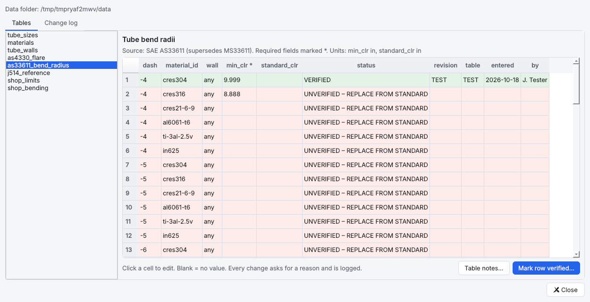
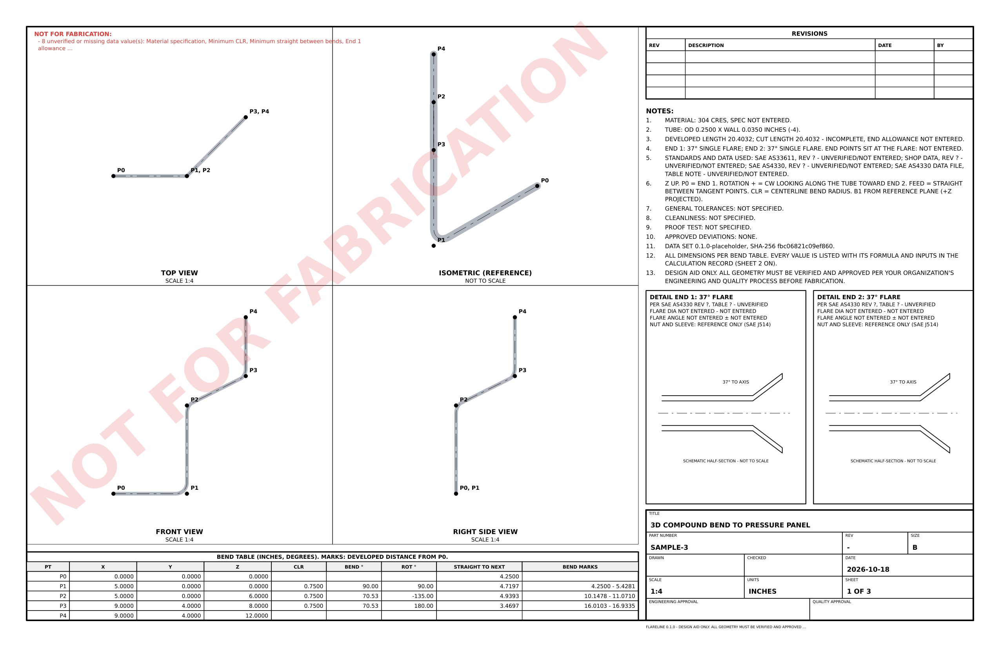

# FlareLine user guide

FlareLine is a design aid for rigid tube assemblies with 37° flared ends. You describe the tube's
route, and FlareLine calculates the bends, straights, developed length and cut length, checks
whether the tube can be made, and shows it in live 3D and 2D.

> **Design aid only.** All geometry must be verified and approved per your organization's
> engineering and quality process before fabrication.

FlareLine works fully offline. It makes no network calls and sends nothing anywhere.

**Contents**
1. [Install and start](#1-install-and-start)
2. [The screen](#2-the-screen)
3. [Your first tube in five minutes](#3-your-first-tube-in-five-minutes)
4. [Describing a route: XYZ, LRA and Legs](#4-describing-a-route-xyz-lra-and-legs)
5. [Ends, allowances and cut length](#5-ends-allowances-and-cut-length)
6. [Checks: errors, warnings and what to do](#6-checks-errors-warnings-and-what-to-do)
7. [Explain: where every number comes from](#7-explain-where-every-number-comes-from)
8. [Entering and verifying standards data](#8-entering-and-verifying-standards-data)
9. [Exporting drawings and approved deviations](#9-exporting-drawings-and-approved-deviations)
10. [Files, autosave and the audit log](#10-files-autosave-and-the-audit-log)
11. [Keyboard shortcuts](#11-keyboard-shortcuts)
12. [Troubleshooting](#12-troubleshooting)
13. [Not in this version yet](#13-not-in-this-version-yet)

---

## 1. Install and start

Until the packaged `.exe` arrives (Phase 6), FlareLine runs from source with Python 3.12 on Windows.

```
cd flareline
python -m venv .venv
.venv\Scripts\activate
pip install -e .[gui]
python -m flareline.app
```

Next time, run `.venv\Scripts\activate` and then `python -m flareline.app`. Each start shows
the disclaimer; press Enter or Esc to close it.

## 2. The screen


| Area | What it is |
|---|---|
| **Red banner** (top) | Shown while any standards or shop value used in the calculation is missing or unverified. Hover over it for the full list. |
| **Steps** (left) | The guided wizard: 1 Tube spec → 2 Ends → 3 Route & bends → 4 Check → 5 Drawing. **Next** and **Back** at the bottom, or Ctrl+1 … Ctrl+5. |
| **3D** (centre) | The tube with its true OD and wall. Drag to orbit, middle-drag or Shift-drag to pan, wheel or right-drag to zoom. The buttons give Fit, Iso, Front, Top, Right, Measure and Section. |
| **2D** (right) | An orthographic view: Top (X-Y), Front (X-Z) or Side (Y-Z). Wheel to zoom, drag to pan, double-click to fit. **Dimensions are true 3D lengths, not projected lengths.** |
| **Bend table** (bottom left) | The route, editable as XYZ, LRA or Legs. White cells are inputs; shaded cells are calculated. |
| **Warnings / Explain** (bottom right) | Everything that needs attention, and the formula behind whatever number you last selected. |
| **Status bar** | Developed and cut length, plus the data set version and its fingerprint. |

The tube is drawn in the **Z-up** coordinate system. **P0** is end 1 and the last point is end 2.

## 3. Your first tube in five minutes

1. **File → Open sample → Simple 90.** The tube has three points: P0 (0, 0, 0), P1 (8, 0, 0)
   and P2 (8, 6, 0), with one 90° bend at a 0.75 in CLR. The sample's wall and CLR are example
   inputs, not standards values.
2. **Step 1 · Tube spec.** Size −4, material 304 CRES, wall 0.0350. The chips beside OD, Wall,
   Min CLR and Material spec show where each value came from (see the colours below).
3. **Change the route.** In the bend table (XYZ), click P2's **Y** cell, type `10` and press
   Enter. The 3D view, the 2D view, the table and the warnings all update. The developed
   length grows by exactly 4.0000 in.
4. **Undo:** Ctrl+Z puts it back. **Redo:** Ctrl+Y.
5. **Step 3 · Add leg** (Ctrl+L) adds a 6 in leg turned 90° from the last one, using the "CLR
   for new bends" value. **Remove last leg** takes it away.
6. **Step 4 · Check** shows bends, centerline / developed / cut length, the error and warning
   counts, self-interference, and whether a release drawing would be allowed.
7. **Save:** Ctrl+S saves a `.flareline.json` project. Opening a sample always opens it as
   *Untitled*, so a sample is never overwritten.

**What the status chips mean**

| Chip | Meaning |
|---|---|
| green **VERIFIED** (or DERIVED) | Entered from a named source with revision, table and date, or follows from a definition (e.g. OD = dash/16). |
| purple **USER INPUT** | You typed it into the project (e.g. the wall). |
| grey **DEFAULT** | A neutral default: arc factor 1.0, no per-bend adjustment, no springback. |
| red **UNVERIFIED** / **MISSING** | Not yet entered, or entered but not verified. Drives the red banner and blocks a release drawing. |

## 4. Describing a route: XYZ, LRA and Legs

The three buttons above the bend table show the **same tube** three ways. Edit whichever form
you have; the others follow.

| Mode | Each row | Use it when |
|---|---|---|
| **XYZ** | A point (X, Y, Z) and the CLR at that bend | You have intersection points from a model or a layout. |
| **LRA** | Y = **feed**, the straight between tangent points; B = rotation; C = bend angle; CLR | You are working from, or producing, bender data. |
| **Legs** | Point-to-point leg length, B, C, CLR | You have a drawing dimensioned to the intersection points. |

**Rotation (B)** is the angle between one bend's plane and the next bend's plane, measured
about the straight between them. You choose how it is shown in **Step 3 → Conventions**:

- **+ = CW** or **+ = CCW**
- **viewed looking toward end 2** or **toward end 1**

This changes only the sign you see. The saved tube does not change. The first bend's B is
measured from a reference plane (+Z, or +Y if the first leg is vertical), so B1 = 0 bends
toward +Y when the tube starts along +X.

Other useful facts:
- **Bend angle (C)** must be between 0° and 180°. A 0° "bend" is allowed but flagged INFO,
  because the point is redundant.
- **CLR** can differ at every bend. **Apply CLR to all** sets every bend to the Step 3 value.
- **Reverse ends** describes the same tube from the other end and swaps the end types.
- With **Apply springback** on (Step 3), the LRA table adds a **C at bender** column (design
  angle + springback from the shop table). A `*` means the angle is outside the table range.
- **Display unit** (Step 1) switches between in and mm. Everything is stored in inches at full
  precision. Display shows 4 decimals for lengths and 2 for angles.

Every rule above is written out in [`CONVENTIONS.md`](CONVENTIONS.md).

## 5. Ends, allowances and cut length

In **Step 2** choose each end: **37° single flare**, **Plain / cut**, or **Flareless
(placeholder)**.

- The **end points** (P0 and the last point) **sit at the flare**. Exactly where on the flare
  is a note in the AS4330 data (Tools → Standards data → as4330_flare → **Table notes**). It
  is printed on drawings.
- The **allowance** is the stock from the end point to the cut end that the flare uses up. It
  comes from the AS4330 data for a flared end, and is 0 for a plain end.
- **Cut length = developed length + end-1 allowance + end-2 allowance.** If an allowance is
  missing, the cut length is marked **(incomplete)** everywhere it appears.
- **Developed length** = straights + bend arcs (R × angle), with the shop arc factor and
  per-bend adjustment applied. These default to 1.0 and 0, i.e. pure centerline.
- **Bend marks**: the LRA table's **Marks from P0** column gives the start and end of each
  bend, measured along the developed tube from the P0 end point. Add the end-1 allowance to
  measure from the cut end of the stock. This is the column to use with a hand bender.

## 6. Checks: errors, warnings and what to do

**Errors** (red) mean the tube cannot be made as described. **Warnings** (amber) mean a
limit is broken or a data value needs attention. **Info** is for awareness only. Select a
row to see its calculation in **Explain**. The self-interference check runs a moment after
you stop typing ("checking…").

| Check | Severity | Meaning | What to do |
|---|---|---|---|
| ZERO_LENGTH_LEG | Error | Two points are in the same place | Move or delete one point |
| CLR_NOT_POSITIVE | Error | A bend radius is 0 or negative | Enter a positive CLR |
| BEND_180 | Error | The tube doubles straight back | Split into two bends or change the route |
| CLR_LE_HALF_OD | Error | CLR ≤ OD/2: physically impossible | Increase the CLR |
| BEND_OVERLAP | Error | Two bends need more straight than the leg has (tangent points cross) | Lengthen the leg, reduce a CLR or reduce an angle |
| BEND_PAST_END | Error | A bend starts before the tube end | Lengthen the end leg |
| SELF_INTERFERENCE | Error | Two parts of the tube touch or cross | Re-route; the 3D view marks the spot in red |
| FLARING_NOT_PERMITTED | Error | The materials table says this material may not be flared | Change the material or the end type |
| UNKNOWN_SIZE / UNKNOWN_MATERIAL | Error | Not in the data files | Pick from the list, or add it to the data |
| CLR_BELOW_MIN | Warning | CLR is below the AS33611 minimum (source named) | Increase the CLR, or get an approved deviation |
| STRAIGHT_BELOW_MIN | Warning | Straight between bends is shorter than the bender can clamp | Lengthen the leg |
| END_STRAIGHT_BELOW_MIN | Warning | End straight too short for the flare tool, nut and sleeve | Lengthen the end leg |
| MISSING_DATA | Warning | A standards or shop value the calculation needs is empty | Enter it (section 8) |
| UNVERIFIED_DATA | Warning | A value is entered but its row is not verified | Verify the row (section 8) |
| CUT_LENGTH_INCOMPLETE | Warning | An end allowance is missing | Enter the AS4330 allowance |
| FLARING_NOT_CONFIRMED | Warning | The materials table doesn't say whether flaring is permitted | Fill in `flaring_permitted` |
| WALL_NOT_SET / WALL_NOT_IN_DATA | Warning | No wall, or a "from data" wall not in the wall table | Enter the wall |
| SPRINGBACK_EXTRAPOLATED | Warning | Bend angle outside the springback table | Extend the table with test-bend data |
| IMAGE_APPROXIMATE | Warning | Route came from an image and is not confirmed (Phase 5) | Confirm every dimension |
| ZERO_ANGLE_BEND | Info | A point lies on a straight line | Usually delete it |
| DEFAULT_DATA | Info | A neutral default is in use (e.g. arc factor 1.0) | Replace with shop data when you have it |
| FLARELESS_PLACEHOLDER | Info | Flareless ends aren't modelled yet | — |
| INTERFERENCE_NOT_CHECKED | Info | Self-interference couldn't be checked (no OD, or errors first) | Fix the errors above it |

A **release drawing** (section 9) needs: no errors, no missing or unverified data, the
interference check complete, and, for image-derived routes, every dimension confirmed.
Anything else is watermarked **NOT FOR FABRICATION**.

## 7. Explain: where every number comes from

Click any calculated number to see how it was produced:

- a cell in the bend table
- a dimension in the 2D view (`L0 5.0000`, `B1 90.00° R0.7500`)
- a warning

The **Explain** tab shows the formula, every input at full precision, and the source. For
example, a tangent length shows `T = R * tan(theta / 2)` with R and θ. A data value shows its
standard, revision, table and data file row.

The main formulas (centerline, inches):

| Quantity | Formula |
|---|---|
| Bend angle θ | atan2(\|u × v\|, u · v) for incoming / outgoing directions u, v |
| Tangent length T | R · tan(θ/2) |
| Arc A | R · θ |
| Straight S | leg − T(start) − T(end) |
| Developed | ΣS + Σ(A · arc factor + per-bend adjust) |
| Cut | developed + end allowances |

## 8. Entering and verifying standards data

FlareLine ships with **no standards values**, by design: they must come from your licensed
copies of SAE AS4330, AS33611 and J514, and from your shop. Until you enter them, the red
banner stays up and no release drawing can be made.

Open **Tools → Standards & shop data…** (Ctrl+D).



*Screenshot values 9.999 and 8.888 are TEST values, not standards data.*

1. Pick a table on the left. Required fields are marked `*`; the units are listed above the
   grid.
2. **Enter a value.** Click the cell, type, and press Enter. You are asked for a reason; the
   first time, also your name. Leave a cell blank for "no value". Lists use commas
   (`0.035, 0.049`). Springback points use `angle:springback; …` (`0:0; 90:3`). Yes/no fields
   take `yes` or `no`.
3. **Verify the row.** Select it and click **Mark row verified…**. Enter the standard,
   **revision**, **table / figure**, and date. FlareLine refuses if any required value in the
   row is empty. The row turns green.
4. **Table notes…** edits notes such as the AS4330 **end point definition**. A note can be
   marked verified only if it isn't empty.
5. The **Change log** tab lists every change: when, who, table, row, field and reason. The full
   before/after record, with file fingerprints, is in `CHANGELOG.jsonl`.

Rules that protect you:
- **Editing a value in a verified row turns the row back to UNVERIFIED** until someone
  re-verifies it.
- A data file that breaks a rule (wrong type, duplicate row, VERIFIED without its source)
  will not load. FlareLine tells you why, and runs on the empty placeholder data until it is
  fixed.
- Changing any data file changes the **data set fingerprint** in the status bar. It is
  recorded in the audit log and printed in the drawing notes.

**Where the data lives:** `%APPDATA%\FlareLine\FlareLine\data`. It is copied from the
placeholders on first run, and updates never overwrite it. Back it up and keep it under your
configuration control.

**What to fill in:** [`STANDARDS_DATA_FIELDS.md`](STANDARDS_DATA_FIELDS.md) lists every empty
field. Regenerate it with `python -m flareline.data.fields_report "%APPDATA%\FlareLine\FlareLine\data"`.

**Suggested practice:** one person enters values, and a second person checks them against the
standard and marks the row verified. Agree with your quality group who may verify.

## 9. Exporting drawings and approved deviations

**Step 5 · Drawing** holds the title block (part number, title, revision, drawn / checked by),
the notes (general tolerances, cleanliness, proof test) and the revision history, one line per
revision: `A | Initial release | 2026-10-18 | JS`. The last four are printed. The step also shows
whether the drawing will be releasable.

**File → Export drawing…** (Ctrl+E, or the button in step 5):

| Format | What you get |
|---|---|
| **PDF** | Sheet 1 is the drawing. Sheets 2 onward are the **calculation record**: every input with its status and source, and every calculation with its formula and full-precision inputs. |
| **DXF** | Model space holds the **true-size 3D centerline** (lines and arcs in their own bend planes, inches) for CAD. Paper space ("SHEET") holds the drawing. |
| **PNG** | Sheet 1 as an image, for a quick message. |
| **CSV** | The bend table at full precision, with a header giving the part, data set fingerprint, conventions and release status. |

Sheet sizes ANSI A, B or D, landscape. B is the most legible for most tubes.



*Example: the 3D compound sample on the placeholder data, so it is watermarked.*

What is on sheet 1:
- Third-angle views at one standard scale: top above front, right side to the right of front.
  An isometric is included for reference, not to scale. Coinciding points share a label
  ("P1, P2").
- The bend table: X, Y, Z, CLR, bend, rotation, straight to next, and bend marks (plus the
  angle at the bender when springback is on).
- A flare detail for each 37° end, with values from the AS4330 data and a schematic
  half-section that is not to scale.
- Numbered notes: material, OD × wall, developed and cut length, standards used with
  revisions, conventions, tolerances, cleanliness, proof test, approved deviations, data set
  fingerprint and the disclaimer.
- The revision table and the title block. Approval boxes are left blank for signature.

**Release rule.** A drawing is printed clean only when there are no errors, every data value
used is verified (or an approved deviation), the interference check is complete, and any
image-derived route is confirmed. Otherwise every sheet-1 view carries a **NOT FOR
FABRICATION** watermark and a list of the reasons. The CSV header says the same. With the audit
log on, each export is recorded with its formats, size and status.

**Tools → Approved deviations…** replaces a data value for this project only, for example an
approved deviation to the minimum CLR. Enter the value (inches), the approval reference or
reason, and who approved it. The date defaults to today. FlareLine refuses a deviation without
a reference and an approver. A deviation shows as **USER INPUT**, is listed in Warnings, and is
printed in the drawing notes. Clear the value to remove it; Ctrl+Z undoes it. Use deviations
only through your organization's approved process.

**Help → Save quick-start guide (PDF)** writes the one-page quick start.

## 10. Files, autosave and the audit log

- **Projects** are readable JSON (`.flareline.json`) with a schema version. FlareLine refuses a
  file from a newer version rather than guess.
- **Autosave** runs every minute while there are unsaved changes, to
  `%APPDATA%\FlareLine\FlareLine\autosave\`. Your project file is only written when you save.
- **Audit log** (**File → Write audit log**, saved with the project): every complete check
  appends one line to `%APPDATA%\FlareLine\FlareLine\audit.jsonl`. Each line holds the time,
  user, project and data set fingerprints, every input with its status and source, every
  calculation, and every warning.
- **Theme:** View → System / Light / Dark.
- **How-to panel:** F1.

## 11. Keyboard shortcuts

| Keys | Action |
|---|---|
| Ctrl+N / Ctrl+O / Ctrl+S / Ctrl+Shift+S | New / open / save / save as |
| Ctrl+Z / Ctrl+Y | Undo / redo |
| Ctrl+1 … Ctrl+5 | Wizard step 1 … 5 |
| Ctrl+L | Add leg |
| Ctrl+Shift+X / L / G | Bend table: XYZ / LRA / Legs |
| Ctrl+D | Standards & shop data |
| Ctrl+E | Export drawing |
| F1 | How-to panel |
| F, 0, 1, 2, 3 (3D view focused) | Fit, iso, front, top, right |
| M, S (3D view focused) | Measure, section |
| Esc | Close a dialog |

## 12. Troubleshooting

| Symptom | Cause and fix |
|---|---|
| The red banner never goes away | Expected until every value the tube uses is entered and verified. Hover over the banner to see which. |
| "3D view unavailable on this machine" | OpenGL could not start (remote desktop or old graphics driver). The 2D view, table and all checks still work. Update the graphics driver or run locally. |
| "Data set error" at start | A data file was edited outside FlareLine and breaks a rule. The message names the file and row. Fix it, or restore it from your backup. |
| LRA / Legs buttons show XYZ only | The route has an error (e.g. coincident points). Fix the error first. |
| A number looks rounded | Display only: 4 decimals for lengths, 2 for angles. Explain shows the full value. |
| Measured distance in 3D differs from a dimension | Measure picks points on the tube surface, so it is approximate. Use the bend table and Explain for exact values. |

## 13. Not in this version yet

- **Image trace** from a photo or sketch: Phase 5.
- **Packaged `.exe`** and the first-run interactive tutorial: Phase 6.
